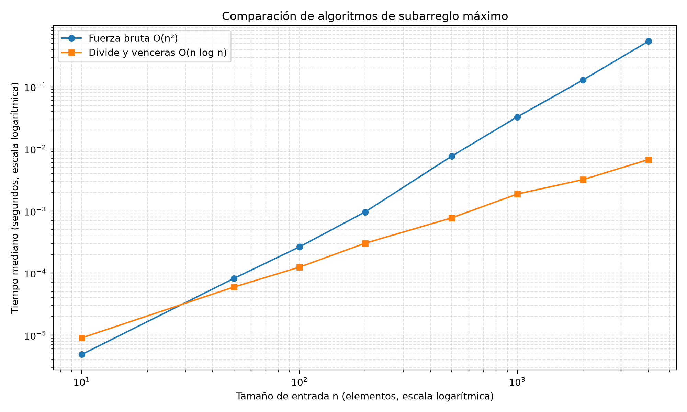

# Lab 2 — Dividir y vencerás

**Estudiante:** Ana María Colorado Varela

**Asignatura:** Análisis de Algoritmos

## Reproducción

Desde esta carpeta, activa el entorno virtual y ejecuta las pruebas y mediciones:

```bash
source ../.venv/bin/activate
python pruebas.py
python medicion.py
```

## Parte 1. Implementación y pruebas

Se implementaron los algoritmos de fuerza bruta y divide y vencerás para encontrar el subarreglo contiguo de mayor suma.

- [Implementación](subarreglo.py)
- [Pruebas automáticas](pruebas.py)

La fuerza bruta mantiene una suma acumulada para cada inicio y recorre los finales posibles, con complejidad Θ(n²). Divide y vencerás resuelve las mitades recursivamente y calcula el mejor tramo que cruza el punto medio, con complejidad Θ(n log n).

Las pruebas incluyen el ejemplo solicitado, listas de un elemento, valores negativos y positivos, un caso cruzado y 20 listas aleatorias reproducibles. También verifican que ambos algoritmos devuelvan la misma suma y no modifiquen la entrada.

## Parte 2. Medición experimental

La medición se realiza en [medicion.py](medicion.py). Se utilizó una semilla fija (42), con listas de enteros aleatorios entre -100 y 100, para tamaños n = 10, 50, 100, 200, 500, 1000, 2000 y 4000. Para cada tamaño se usó la misma lista en ambos algoritmos. Se midieron tres ejecuciones por algoritmo y se tomó la mediana; la generación de datos queda fuera del tiempo medido.



Los ejes están en escala logarítmica para facilitar la comparación de ambas curvas.

## Parte 3. Análisis

### 1. Recurrencia y complejidad

En divide y vencerás, cada llamada resuelve dos subproblemas de tamaño aproximado n/2 y emplea Θ(n) para encontrar el mejor subarreglo que cruza el punto medio. Por tanto:

T(n) = 2T(n/2) + Θ(n).

Por el caso 2 del teorema maestro, como n^(log₂ 2) = n y el trabajo de combinación es Θ(n), el resultado es Θ(n log n). La fuerza bruta tiene complejidad Θ(n²), pues examina Θ(n²) pares de índices y actualiza la suma acumulada en tiempo constante por elemento.

### 2. Comparación con las mediciones

Al duplicar n de 1000 a 2000, la fuerza bruta pasó de 0,032723 s a 0,128417 s, un factor aproximado de 3,92; divide y vencerás pasó de 0,001875 s a 0,003194 s, un factor de 1,70. De 2000 a 4000, los factores fueron aproximadamente 4,21 y 2,11, respectivamente.

Estos resultados son compatibles en general con el crecimiento cuadrático y n log n. En teoría, duplicar n hace que el tiempo cuadrático crezca aproximadamente 4 veces, mientras que para n log n el factor es algo mayor que 2. Las diferencias se deben a variaciones de medición, constantes y costos de ejecución.

### 3. ¿Desde qué tamaño conviene divide y vencerás?

En esta ejecución, con n = 10 la fuerza bruta tardó 0,000012 s y divide y vencerás 0,000024 s. Desde n = 50, divide y vencerás fue más rápido. El punto de cruce puede cambiar según el equipo y las condiciones de ejecución.

### 4. ¿Conviene divide y vencerás para hallar el máximo de un arreglo?

No necesariamente. Se puede dividir el arreglo en dos mitades, hallar el máximo de cada una y compararlos en tiempo constante. La recurrencia es T(n) = 2T(n/2) + Θ(1), cuya solución es Θ(n), igual que recorrer el arreglo una sola vez. La versión recursiva añade sobrecosto de llamadas, por lo que el recorrido iterativo suele ser más eficiente.

### 5. ¿Qué algoritmo recomendaría para n = 1.000.000?

Recomendaría divide y vencerás para este problema. Con n = 4000, la fuerza bruta tardó 0,540360 s y divide y vencerás 0,006737 s. Extrapolando desde ese tamaño con los modelos asintóticos, la fuerza bruta tardaría aproximadamente 9,4 horas y divide y vencerás alrededor de 2,8 segundos para n = 1.000.000.

Estas cifras son estimaciones, no mediciones directas. Suponen que se mantienen los modelos de crecimiento y las condiciones de ejecución; el tiempo real puede variar.
