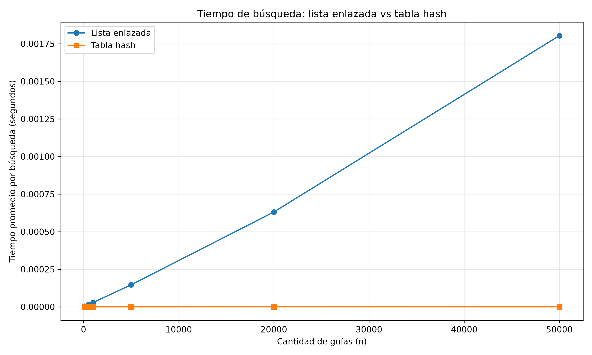
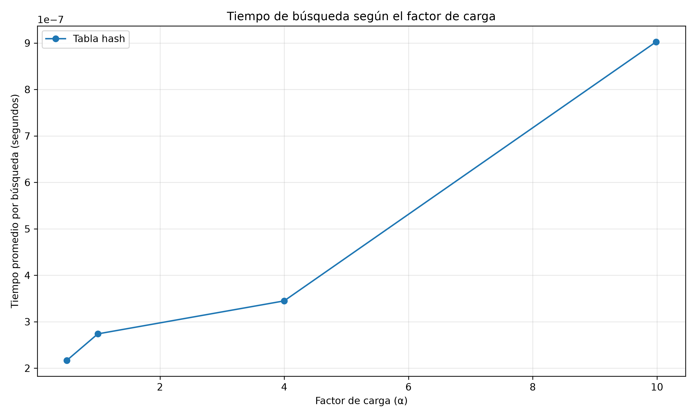

# Laboratorio 3 — Estructuras de datos

**Estudiante:** Ana María Colorado Varela  
**Asignatura:** Análisis de Algoritmos

## Objetivo

Comparar experimentalmente el rendimiento de una lista enlazada simple y una tabla hash con encadenamiento para la búsqueda de guías de envío. También se analiza el efecto del factor de carga sobre el tiempo de búsqueda.

## Parte 1. Implementación de estructuras

Se implementaron las estructuras solicitadas para administrar las 400.000 guías de envío de Rutas del Caribe.

- [Código de las estructuras](estructuras.py)
- [Pruebas automatizadas](pruebas.py)

La clase `ListaEnlazada` permite insertar elementos al inicio en Θ(1) y buscar una guía en Θ(n) en el peor caso. La clase `TablaHash` utiliza el método de división `h(k) = k mod m` y resuelve las colisiones mediante encadenamiento con listas enlazadas.

La tabla calcula su factor de carga mediante α = n/m. No se utilizan diccionarios, conjuntos ni la función hash incorporada de Python en la implementación de las estructuras.

### Ejecución de pruebas

Desde la raíz del repositorio, con el entorno virtual activado:

```bash
python lab3-estructuras-datos/pruebas.py
```

Las pruebas verifican listas y tablas vacías, inserciones, búsquedas exitosas y fallidas, colisiones forzadas y equivalencia de resultados en 20 conjuntos aleatorios reproducibles.

## Parte 2. Experimentos y mediciones

El archivo [medicion.py](medicion.py) contiene los experimentos y genera las siguientes gráficas:

### Experimento A. Comparación de estructuras

Se utilizaron seis tamaños: 100, 500, 1.000, 5.000, 20.000 y 50.000 guías. El factor de carga de las tablas se mantuvo aproximadamente en 2.



### Experimento B. Efecto del factor de carga

Se mantuvieron 20.000 guías y se modificó el número de casillas para obtener cuatro factores de carga: aproximadamente 0,5; 1; 4 y 10.



**Metodología:** se utilizaron guías de diez dígitos generadas con semillas fijas y consultas de guías inexistentes. Se midió exclusivamente el tiempo de búsqueda con `time.perf_counter()`, sin incluir la construcción de las estructuras. Cada medición tuvo siete repeticiones y se utilizó la mediana del tiempo por consulta. El experimento A utilizó 1.000 consultas y el B, 200.000.

Para reproducir los experimentos:

```bash
python lab3-estructuras-datos/medicion.py
```

### Resultados del experimento A

| n | Factor de carga | Lista (s) | Tabla hash (s) |
|---:|---:|---:|---:|
| 100 | 1,8868 | 0,0000032374 | 0,0000001705 |
| 500 | 1,9920 | 0,0000143030 | 0,0000001678 |
| 1.000 | 1,9881 | 0,0000288736 | 0,0000001752 |
| 5.000 | 1,9976 | 0,0001464015 | 0,0000001912 |
| 20.000 | 1,9986 | 0,0006312192 | 0,0000005542 |
| 50.000 | 1,9990 | 0,0018040126 | 0,0000002064 |

### Resultados del experimento B

| Factor de carga | Casillas (m) | Tiempo promedio (s) |
|---:|---:|---:|
| 0,4999 | 40.009 | 0,0000002167 |
| 0,9995 | 20.011 | 0,0000002738 |
| 3,9976 | 5.003 | 0,0000003448 |
| 9,9850 | 2.003 | 0,0000009024 |

## Parte 3. Análisis

### 1. Complejidad teórica de búsqueda

En una lista enlazada, una búsqueda fallida debe recorrer todos los nodos porque no existe una forma directa de acceder a una guía. Por tanto, su complejidad en el peor caso es Θ(n).

En una tabla hash con encadenamiento, la búsqueda promedio depende del factor de carga α = n/m. Bajo el supuesto de hashing uniforme simple, la complejidad esperada es Θ(1 + α). Si α se mantiene constante, la búsqueda esperada es Θ(1). En el peor caso, todas las guías pueden terminar en una misma casilla y la búsqueda cuesta Θ(n).

### 2. Comparación de los resultados experimentales

Al pasar de 100 a 50.000 guías, el tamaño aumenta 500 veces. El tiempo de la lista pasa de 0,0000032374 s a 0,0018040126 s, aproximadamente 557,4 veces más. Este crecimiento es cercano al comportamiento lineal esperado.

En la tabla hash, el tiempo pasa de 0,0000001705 s a 0,0000002064 s, aproximadamente 1,21 veces. Aunque existen fluctuaciones de medición, permanece en un orden de magnitud mucho menor.

En el segundo experimento, al aumentar α de 0,4999 a 9,9850, el tiempo pasa de 0,0000002167 s a 0,0000009024 s, aproximadamente 4,16 veces. Esto respalda la relación entre el factor de carga y el costo esperado de búsqueda.

### 3. Colisiones y métodos de resolución

Una colisión ocurre cuando dos claves diferentes producen el mismo índice. Por ejemplo, con m = 7, las guías 10, 24 y 17 generan el índice 3 mediante el método de división.

El encadenamiento almacena los elementos que colisionan en una lista enlazada dentro de la misma casilla. Es sencillo y permite factores de carga superiores a 1, aunque las búsquedas pueden aumentar de costo cuando las listas crecen.

El direccionamiento abierto almacena todos los elementos directamente en el arreglo y busca otras posiciones disponibles mediante sondeo lineal, cuadrático o doble hashing. Puede aprovechar mejor la localidad de memoria, pero su rendimiento se deteriora al llenarse la tabla y requiere un tratamiento especial para las eliminaciones.

### 4. Árbol binario de búsqueda para consultas por rango

Una tabla hash no conserva el orden de las claves. Por ello, encontrar todas las guías comprendidas entre dos valores requiere, en general, recorrer los elementos, con costo Θ(n).

Un árbol binario de búsqueda permite consultas ordenadas y recorridos por rango. Si está equilibrado, una consulta de rango cuesta Θ(log n + k), donde k es la cantidad de resultados.

Si se insertan 400.000 guías ordenadas en un BST sin balanceo, el árbol puede degenerar en una cadena de altura aproximada de 399.999. El total de comparaciones de inserción sería aproximadamente n(n−1)/2 = 79.999.800.000. En un árbol equilibrado, la altura sería cercana a log₂(400.000) ≈ 19 niveles y la construcción mediante inserciones tendría un costo del orden de n log₂(n), aproximadamente 7,45 millones de comparaciones.

### 5. Recomendación para Rutas del Caribe

Se recomienda una solución híbrida: una tabla hash para las consultas individuales del centro de atención y un árbol equilibrado, como AVL o rojo-negro, para las consultas de rangos del área de operaciones.

Para estimar la búsqueda fallida con 5 millones de guías, se conserva el factor de carga cercano a 2 del experimento A. La lista enlazada se estima mediante crecimiento lineal: 0,0018040126 × (5.000.000 / 50.000) ≈ 0,1804 segundos por búsqueda.

Para la tabla hash, se utiliza como referencia el valor medido con 50.000 guías y α ≈ 2: aproximadamente 0,0000002064 segundos por búsqueda. Se espera que el tiempo se mantenga aproximadamente constante si se conserva el factor de carga y una distribución uniforme de las claves.

Estas estimaciones son aproximaciones basadas en las mediciones del equipo y no garantías de rendimiento en producción.